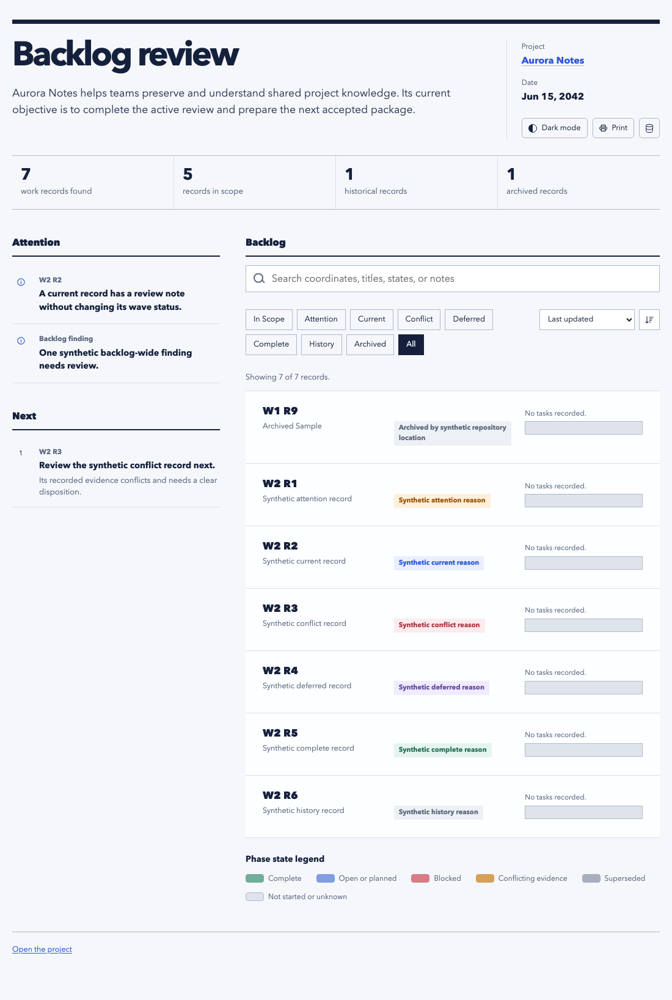
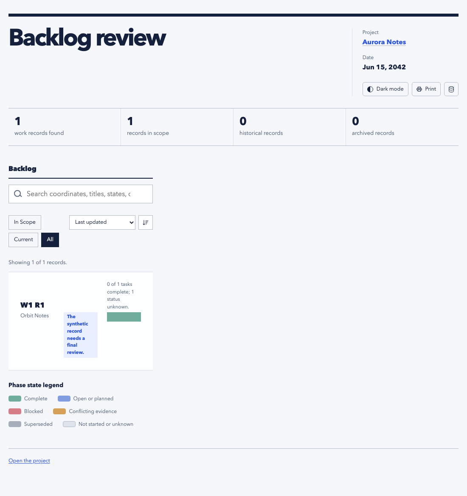
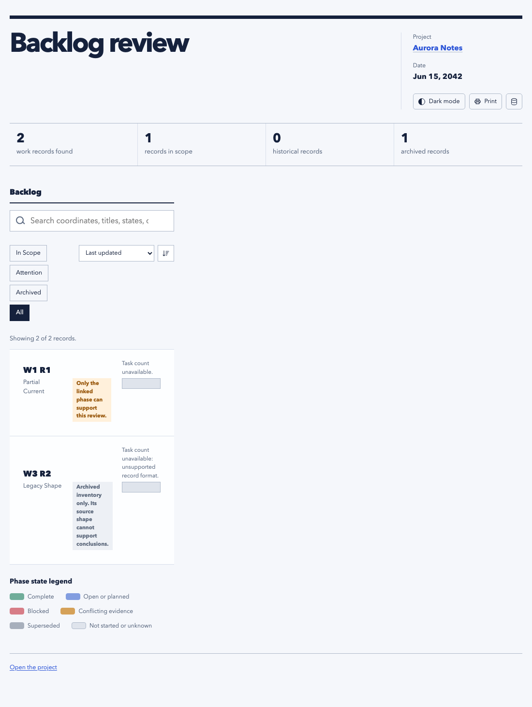

# Task Count Display Review

The owner approved the exact four-state wording on 2026-10-24. The existing card layout stays in place.

| Source state | Card text | Browser result |
| --- | --- | --- |
| Supported, zero tasks | `No tasks recorded.` | Seven cards showed this text. |
| Supported, one task with unknown status | `0 of 1 tasks complete; 1 status unknown.` | The card showed this text. |
| Unsupported record format | `Task count unavailable: unsupported record format.` | The card showed this text. |
| Missing or partial count | `Task count unavailable.` | The card showed this text. |

The check used synthetic report models and the generated static renderer in Chromium. It found no `0 of 0 tasks complete` text. The text stayed readable in the existing narrow card. Long messages wrapped onto more than one line.

This is a source and browser check. It does not prove delivery in the installed MCP host. P11 owns that check.
